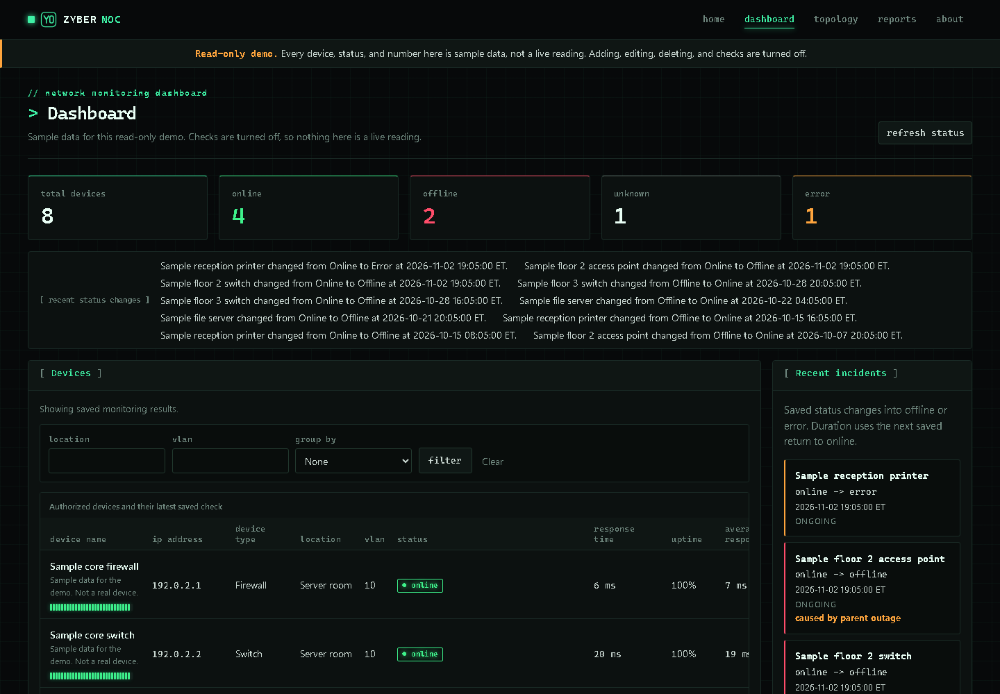
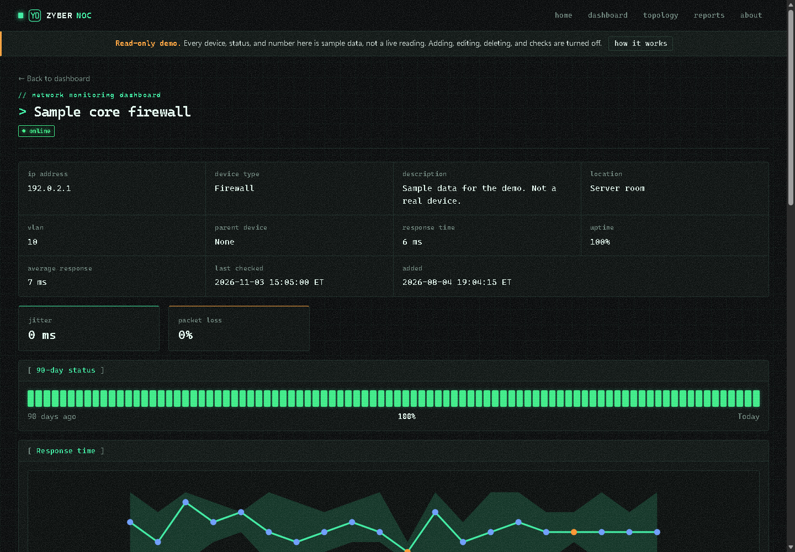
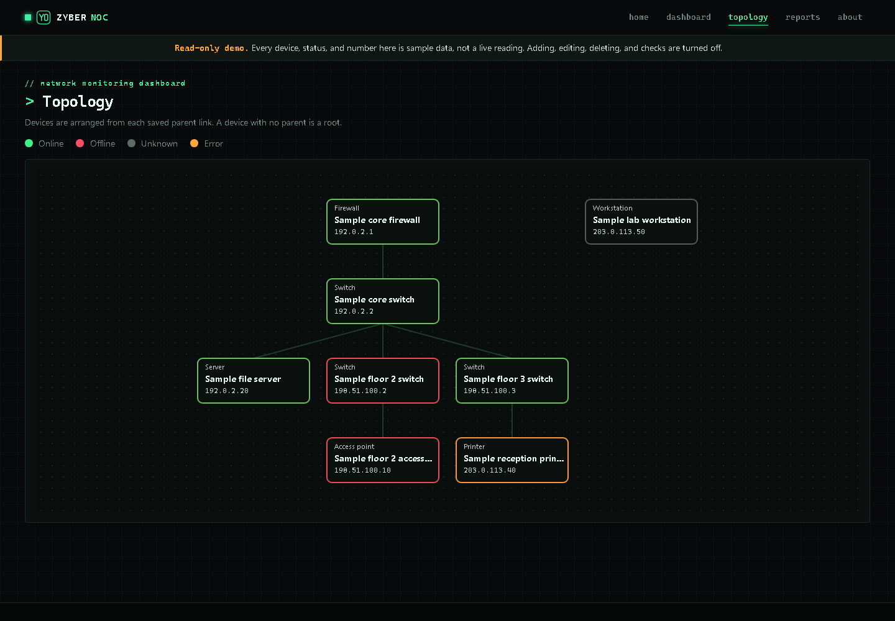
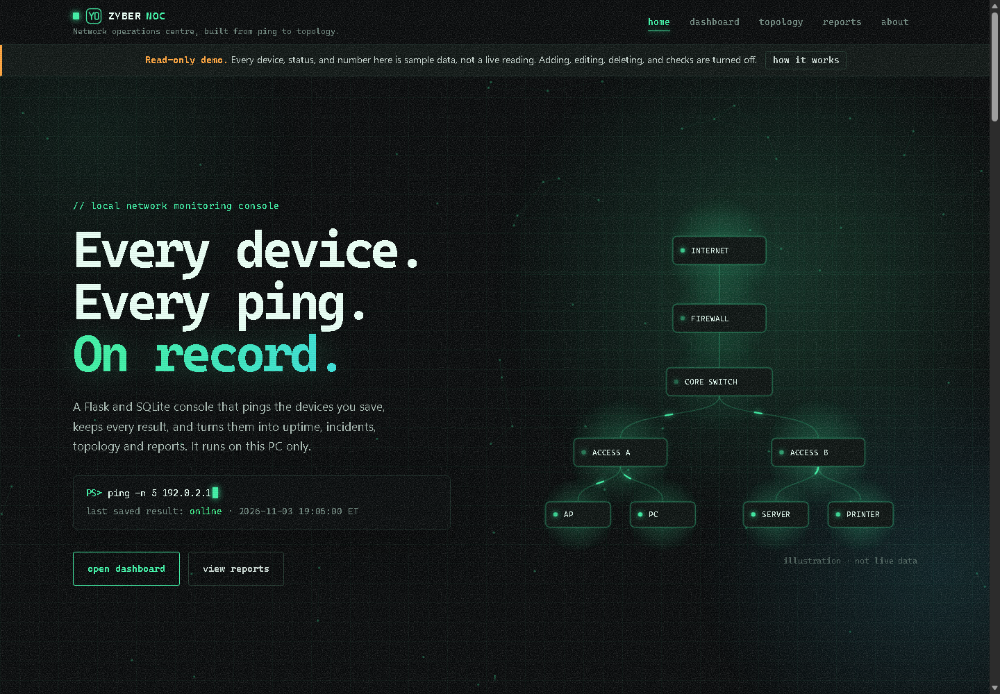
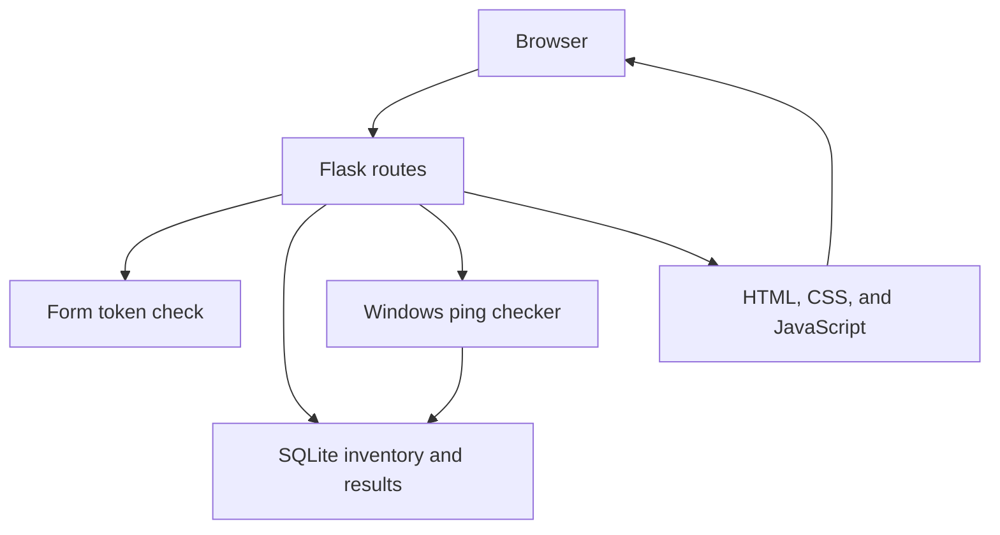

# Zyber NOC

[](https://github.com/bankai9278/Zyber-NOC/actions/workflows/tests.yml)

**Live site: [zybernoc.pythonanywhere.com](https://zybernoc.pythonanywhere.com)** shows the real status of devices on my home network, sent in by a small agent on my PC. Anyone can look; only I can sign in and make changes, and IP addresses and descriptions stay hidden from the public. Want to click around? The **Try it** page has a sandbox with pretend devices.

Zyber NOC is a small network operations console. You save the devices you're allowed to monitor, it pings them, keeps every result in SQLite, and turns those results into uptime, incidents, a 90-day status bar, and a topology map. I built it with Python, Flask, and plain HTML, CSS, and JavaScript as a portfolio project for junior network technician and IT support roles.

| Dashboard | Device page |
|---|---|
|  |  |
| **Topology** | **Home** |
|  |  |

I took these screenshots from the app in demo mode, so every device and number in them is sample data on documentation addresses.

## About this project

I wanted something closer to real NOC work than a course lab: keep a list of devices, check them, record what happened, and make outages easy to spot. It started as a Windows app on my own PC and still runs that way by default. It only checks addresses I've saved. It doesn't discover devices or scan a subnet, and it isn't meant to run a production network.

The public site runs the same code in **hosted mode**. The website itself never pings anything. An agent on my home PC checks the devices every 5 minutes and posts the results (see [Hosted live mode](#hosted-live-mode-with-a-home-agent-optional)). There's also a **read-only demo mode** with sample data (see [Read-only demo](#read-only-demo-for-hosting)).

## Features

**Inventory**

- Save a device with a name, an IPv4 or IPv6 address, a type, and optionally a description, location, VLAN, and parent device.
- Bad input is refused: missing fields, invalid or duplicate addresses, and broadcast, multicast, or unspecified addresses.
- Edit a device at any time, including its parent. Its history stays with it, even after an IP change. A device can't be its own parent, and a parent link that would make a loop is refused.
- Delete only after a confirmation page. The device and its history go; any children stay, with no parent.

**Checks**

- **Check now** pings one device (five echo requests). **Check all** pings up to 20, two at a time.
- **Check port** tries TCP 22, 53, 80, 443, or 3389 on a saved device. No other port is ever opened.
- **Poll SNMP** reads each interface's name, up/down status, and traffic counters over SNMP v2c. It's read-only and uses only the standard library. Two polls turn the counters into traffic rates. A poll never changes ping status, uptime, or incidents.
- Every finished check is saved, including errors. A device stays **Unknown** until a check is saved; the app never invents a status.
- Scheduled checks are off by default. When turned on in config, a background thread runs Check all every so many minutes (1 at the least).

**Dashboard and history**

- Counts for total, online, offline, unknown, and error, plus the latest response time and check time for each device.
- Filter the table by location or VLAN, or group it by either. Summary counts always cover every device.
- Uptime and average response time from saved results only.
- The 10 most recent status changes, and the 10 most recent incidents (changes to offline or error), with how long each lasted or `ongoing`.
- When a device and its parent are both offline, the badge says **Unreachable via** the parent. A child's incident is marked as caused by the parent outage when the parent was already down.
- Device page: the last 20 checks, a response-time chart (median line, min-to-max band, points coloured by packet loss), jitter and packet loss from the latest ping, and a 90-day status bar. Each dashboard row has a 30-day bar.
- The dashboard and the topology map keep themselves current. While the page is open and visible, they check the saved results every 45 seconds (the same public JSON, so no addresses when signed out). When a newer result has arrived, counts, rows, colours, and links update in place and each device sends out a short sonar ring in its status colour; with reduced motion they just update. Demo mode does not poll.
- A light next to ZYBER NOC says **live** (green, with how long ago) when the newest saved result is under 10 minutes old, and **agent offline** (grey) when it isn't; the demo says **demo**. Pages that keep themselves live update it as they go.
- On phones, the top menu is replaced by a bottom tab bar (Home, Dashboard, Map, Reports, More) with thumb-sized buttons; More opens About, Try it, and Sign in or out. It works without JavaScript, leaves room for the phone's home bar in the installed app, and computers keep the normal top menu.
- **Refresh status** reloads saved results without pinging again. **Download CSV** exports a device's full history in UTC.
- Times show in America/Toronto; the database stores UTC. `/health` returns a small JSON health check.

**Topology**

- `/topology` draws the parent and child tree as inline SVG, with each device linking to its page. **Show 3D globe** draws the same devices on a globe you can turn (Three.js, loaded only when you press it).

**Hosting, sign-in, and phone**

- Hosted live mode: the website never pings. A home agent (`agent/agent.py`) checks the saved devices every 5 minutes and posts the results with a shared key. One admin sign-in. Signed-out visitors see names and statuses but not addresses or descriptions. The dashboard shows when the last result arrived.
- A **Try it** sandbox at `/try`: visitors can add, edit, delete, and pretend-check up to 8 made-up devices. They live only in that visitor's session cookie, never in the database, reset after an hour, and are never pinged or contacted. Their history is random and labelled as made up.
- Installs as an app on Android. A web app manifest is at `/manifest.webmanifest`, the icons are drawn by `tools/make_icons.py` with the standard library, and a service worker is at `/service-worker.js`. The worker stores only files under `/static/` and an offline page. Pages, `/api/` JSON, sign-in, and CSV downloads always come from the network, so a phone never shows an old status as live. In Chrome on Android, open the site and choose **Add to Home screen** or **Install app**.
- Optional outage alerts, off by default. When on, a check that changes a device to offline or error is written to `instance/alerts.log` and can also be emailed through your own mail server. Demo mode never alerts.

**Look and feel**

- A Cyber terminal theme (`app/static/css/theme-terminal.css`, loaded after `style.css`). Headings use Space Grotesk, served from `app/static/fonts/` (never a font CDN); body text and labels use system fonts and Cascadia Mono.
- **Follow a ping** on the home page: as you scroll, a packet travels from this PC through the router to a device and back, while six short steps explain the echo request, TTL, the echo reply, latency, median and jitter, timeouts and packet loss, and how the result is saved. The last step shows the newest saved check (name, status, response time, and how long ago; never an address), or says plainly that nothing has been checked yet. Without motion it stays a readable list.
- A home page at `/` with saved totals, a 30-day report at `/reports`, and an about page at `/about`. Numbers on those pages come only from saved rows. The animations in `premium.js` and `effects.js` stay off when the system asks for reduced motion, unless the visitor turns them on with the footer switch. On desktop with full motion, the home page adds GSAP scroll scenes.
- The about page is my own write-up: why I built this, the Mohawk College team project it grew from (NETTRIO, a network design proposal for Skyline Paralegal), a diagram of that core, distribution, and access design, my skills, and what I plan next. Planned items, such as certifications, are listed as goals, not as done.
- My `YO` initials logo (`app/static/img/logo-yo.svg`) is the favicon, sits next to ZYBER NOC in the header and footer, and appears larger on the about page.

## Networking concepts

These are the network support ideas I practised while building it:

- **Authorized inventory.** A technician monitors devices they are allowed to check. The app pings only addresses that were added to the inventory. It does not scan an IP range or accept a hostname.
- **ICMP echo.** **Check now** uses Windows `ping`, which sends five ICMP echo requests and waits for echo replies. A reply makes the device **Online**. No reply before the timeout makes it **Offline**.
- **Response time, jitter, and loss.** Windows reports each round trip in milliseconds, such as `time=12ms`. A reply faster than 1 millisecond is stored as 0 ms. The saved response time is the median of the replies. Jitter is the average change between consecutive replies. Packet loss is the share of the five requests that got no reply. If none come back, loss is 100 and no latency number is invented.
- **Upstream dependency.** A parent device is the path used to reach a child. If both are offline in the saved results, the child is shown as unreachable through that parent. The map on `/topology` draws those links.
- **Unknown is not the same as offline.** Unknown means no check has been saved yet. Offline means a check ran and the device did not reply.
- **Ping is not proof that every service is up.** A firewall or host policy can block ICMP while the device is still reachable on another protocol. The TCP check only tries to connect to one of five ports: 22, 53, 80, 443, or 3389. It does not test websites or name resolution.
- **One address, one device.** Broadcast and multicast addresses can represent many hosts, so they are rejected. Each saved address must be unique.
- **Check limits.** The default check sends 5 echo requests and waits 1000 milliseconds for each reply. A repeated check is skipped for 15 seconds, and a second check is rejected while one is already running. These limits avoid sending a burst of traffic from a mis-click.

## Architecture

The browser only ever talks to Flask. Flask checks each form, then hands the work to the database or the Windows ping checker. Pages are rendered on the server, and a small script reloads the dashboard from saved results.



| Module | Responsibility |
|---|---|
| `run.py` | Starts the local server |
| `app/__init__.py` | Builds the Flask app, creates the database, and registers routes |
| `app/config.py` | Host, port, database path, ping limits, and history limit |
| `app/routes/devices.py` | Dashboard, topology, add, edit, detail, check, and delete pages |
| `app/routes/site.py` | Home, reports, and about. These pages only read saved data |
| `app/routes/health.py` | `GET /health` |
| `app/routes/agent.py` | Agent API for hosted mode: `GET /api/agent/devices` and `POST /api/agent/results`, both behind the agent key |
| `app/auth.py` | Admin sign-in and sign-out, the sign-in rate limit, and hiding addresses and descriptions when signed out |
| `agent/agent.py` | Home agent for hosted mode. Runs once: fetch devices, check them, post the results |
| `tools/zyber_secrets.py` | Makes the agent key and the admin password hash |
| `tools/make_icons.py` | Draws the app icons `icon-192.png` and `icon-512.png` with the standard library |
| `app/database.py` | SQLite tables and parameterized queries |
| `app/monitoring.py` | Validates one saved address, runs Windows ping, and connects to an allowed TCP port |
| `app/presentation.py` | Turns saved values into labels, Toronto times, the topology map, the latency chart, and the status bars |
| `app/csrf.py` | Checks the form token on submissions that change data |
| `app/templates/` | Server-rendered HTML, including `app/templates/site/` for home, reports, and about |
| `app/static/` | `style.css`, `theme-terminal.css`, `premium.css`, `effects.css`, the dashboard and form scripts, `premium.js`, `effects.js`, the `grain.svg` texture, the `logo-yo.svg` initials logo (also the favicon), the older `favicon.svg`, and three static page images |

The main tables are these (SNMP polls and interfaces have their own two tables):

- `devices` stores the name, IP address, device type, description, optional location, optional VLAN, optional parent device, and the time the device was added.
- `monitoring_results` stores the device, status, response time in milliseconds when one was measured, a short error note when needed, whether the check was ping or TCP, the TCP port when one was used, the ping minimum, median, maximum, jitter, and packet loss when those were measured, and the UTC time of the check.
- `status_changes` stores a device, the previous status, the new status, and the UTC time. A row is added only when the new status differs from the previous saved result.
- `check_requests` stores Check now requests queued in hosted mode: the device, ping or TCP and port, when it was asked for, and when the agent finished it.

## Technologies

| Technology | Why I used it |
|---|---|
| Python 3.11 or newer | The application, database access, IP validation, ping command, and TCP connection are all Python. SQLite, subprocess, sockets, and time zones come with Python. |
| Flask 3.1.3 | Serves the local pages and forms without a separate frontend application. |
| SQLite | Stores the inventory and check history in one file on this PC. No database server is required. |
| HTML, CSS, and JavaScript | Pages are server-rendered. `style.css` holds the layout. `theme-terminal.css` is the Cyber terminal theme. `premium.css` is the home, reports, and about layout. `effects.css` loads last and holds the page transitions, texture, topology animation, boot intro and scroll story. JavaScript refreshes saved results, shows a loading label, and runs the page effects. Those effects do not run when reduced motion is on. There is no framework and no CDN. Three.js and GSAP are vendored in `app/static/vendor/` and load only on the pages that use them. |
| pytest 9.1.1 | Runs automated tests. Ping tests use stand-in command output, and TCP tests use a stand-in socket, so the test run does not send real network traffic. |

Flask also installs its required libraries, including Werkzeug and Jinja2. Those are not listed separately in `requirements.txt`.

## Windows setup

Install Python 3.11 or newer from [python.org](https://www.python.org/downloads/windows/). During setup, select **Add python.exe to PATH**.

Open PowerShell in this project folder:

```powershell
py -3 -m venv .venv
.\.venv\Scripts\python.exe -m pip install -r requirements.txt
```

Activate the environment when you want `python` and `pip` to point at it:

```powershell
.\.venv\Scripts\Activate.ps1
```

If PowerShell blocks the activation script, skip activation and call `.\.venv\Scripts\python.exe` directly. Do not install these packages into the global Python installation.

The first run creates these local files. Git ignores them:

- `instance/monitor.db`, the SQLite database
- `instance/secret_key`, the key that signs the local session cookie

## Run the application

From the project folder:

```powershell
.\.venv\Scripts\python.exe run.py
```

Open the home page at `http://127.0.0.1:5000/`. The device dashboard is `http://127.0.0.1:5000/devices`. Reports are `http://127.0.0.1:5000/reports` and the project note is `http://127.0.0.1:5000/about`.

The server listens on `127.0.0.1` port `5000`, so only this computer can open it. Debug mode is off. Stop the server with Ctrl+C in that PowerShell window.

Confirm the process is running:

```powershell
.\.venv\Scripts\python.exe -c "import urllib.request; print(urllib.request.urlopen('http://127.0.0.1:5000/health').read().decode())"
```

The health check returns:

```json
{"application": "network-monitoring-dashboard", "status": "ok"}
```

## Run the tests

The tests do not need the web server to be running. From the project folder:

```powershell
.\.venv\Scripts\python.exe -m pytest
```

Ping tests replace the Windows command with saved examples of online, offline, timeout, and failed output. TCP tests replace the socket connection. They do not contact the network.

GitHub Actions runs the same tests on `windows-latest`. The workflow file is `.github/workflows/tests.yml`. The repository is [bankai9278/Zyber-NOC](https://github.com/bankai9278/Zyber-NOC). The badge at the top of this file shows the latest workflow run.

## Add a device and check it

1. Start the application and open `http://127.0.0.1:5000/`. Choose **Dashboard**, or open `http://127.0.0.1:5000/devices`.
2. Choose **Add device**.
3. Enter a device you are allowed to monitor. Use a real IP address from this PC or its local network, such as the IPv4 address shown by `ipconfig`. `127.0.0.1` is a safe loopback test.
4. Save the device. Its status is **Unknown**, and the response time and last checked time say **Not checked**.
5. Choose **Check now** on that row, or open the device and choose **Check now** there. The button says **Checking** while Windows ping sends five echo requests. **Check port** on the device page connects to the selected allowed port.
6. After the page reloads, the status is **Online**, **Offline**, or **Error**. Online includes the median response time in milliseconds. The device page lists the saved check and, when a response time was stored, draws the median and the min-to-max band. Jitter and packet loss appear when the ping stored them.
7. **Check all** checks every saved device that is not still inside the 15-second wait, up to 20 devices. **Refresh status** reloads stored results and does not ping again. Location and VLAN filters change the table only. **Group by** can be None, Location, or VLAN, and it works together with those filters. Each row has a 30-day status bar.
8. **Edit** on a device row or the device page opens a form with the saved values, including Parent device. Saving it returns to the device page. The saved checks stay in place, including after an IP or parent change. **Topology** draws the saved parent links.
9. **Download CSV** saves that device's history, including the ping statistics. **Delete** opens a confirmation page. The device is removed only after **Delete device** is submitted. A child device is kept, and its parent becomes none. The incidents panel lists saved changes to offline or error. It stays empty until one of those changes has been saved. The device page also shows the 90-day status bar.

Use a device you control. Do not add an address at work, school, or another network unless you are allowed to monitor it.

## SNMP interface polling

**Poll SNMP** on a device page sends SNMP v2c GetNext requests to that saved device on UDP port 161 and stores what it answers: each interface's name, whether it is up or down, and its in and out byte counters (64-bit when the device has them, 32-bit otherwise). It only reads. It never sends an SNMP set.

- The community string is `public` unless you set another one before starting the app: `$env:ZYBER_SNMP_COMMUNITY = "your-community"`. It works like a password, so keep it out of files you commit.
- Traffic rates need two answered polls. Poll again after at least 15 seconds and the page shows bits per second in and out for each interface. A 32-bit counter that rolls over is handled; a 64-bit counter that goes backwards means the device restarted, so that rate says Unknown.
- If the device does not answer, the poll is saved as **No reply** and the page keeps showing the interfaces from the last poll that answered.
- Demo mode never polls. It shows sample interfaces for a few sample devices.

### Try it without a switch

`tools/snmp_simulator.py` is a small SNMP agent with four made-up interfaces whose counters grow at a steady rate. It listens on `127.0.0.1` only.

```powershell
.\.venv\Scripts\python.exe tools\snmp_simulator.py
```

In a second PowerShell window:

```powershell
$env:ZYBER_SNMP_PORT = "1161"
.\.venv\Scripts\python.exe run.py
```

Add a device with IP `127.0.0.1`, open it, and press **Poll SNMP** twice, at least 15 seconds apart. Remove `ZYBER_SNMP_PORT` (or open a new window) before polling real equipment, which listens on 161.

## Monitor devices over Tailscale (optional)

[Tailscale](https://tailscale.com) puts your own devices on one private network, even when they are in different places. Each device gets an address from `100.64.0.0/10` (such as `100.101.102.103`) and an IPv6 address in `fd7a:115c:a1e0::/48`. Zyber NOC accepts both kinds like any other single address, so a laptop at home, a Raspberry Pi at a friend's place, or a cloud server can be pinged, port-checked, and polled over SNMP from this PC.

### Set it up on this PC

1. Install Tailscale from PowerShell (Windows asks for administrator approval):

   ```powershell
   winget install --id Tailscale.Tailscale -e
   ```

   Or download the Windows installer from <https://tailscale.com/download/windows>.
2. Open Tailscale from the Start menu and sign in. Every device you sign in with the same account joins your tailnet.
3. Install Tailscale on each device you want to monitor and sign in there too.
4. Find their addresses: `tailscale status` lists every device and its `100.x` address, or open the admin console at <https://login.tailscale.com/admin/machines>.

### Add a tailnet device to Zyber NOC

Add it like any other device, using its `100.x` address (hostnames such as MagicDNS names are not accepted, on purpose). Then:

- **Check now** works when the device allows ping. Windows blocks ping by default; allow "File and Printer Sharing (Echo Request - ICMPv4-In)" on a Windows device you want to ping.
- **Check port** works for 22, 53, 80, 443, or 3389 when that service runs on the device.
- **Poll SNMP** works when the device runs an SNMP agent that allows v2c from your tailnet address.
- Tailscale access controls (ACLs) can block traffic between your devices. The default policy allows it.

### Open the dashboard from your other devices with `tailscale serve`

The app itself still listens only on `127.0.0.1`. `tailscale serve` is a proxy on this PC that makes it reachable from your own tailnet devices over HTTPS, and from nowhere else.

```powershell
tailscale serve --bg 5000
tailscale serve status
```

It prints an address like `https://your-pc.your-tailnet.ts.net`. Open that from your phone or laptop while both are signed in to Tailscale. Turn it off with:

```powershell
tailscale serve --https=443 off
```

Read this before using it:

- Normal mode has **no login**. Anyone on your tailnet can add, edit, and delete devices and start checks. Only serve it when your tailnet holds just your own devices, and remove people from the tailnet you no longer trust. Setting `ZYBER_ADMIN_PASSWORD_HASH` before you start the app adds an admin sign-in (see [Sign-in](#sign-in)).
- To show someone the project safely, serve the read-only demo instead: start the app with `$env:ZYBER_DEMO_MODE = "1"`, then serve that port.
- **Never use `tailscale funnel`.** Funnel publishes the app to the whole internet, and this app's normal mode must never be public.

## Outage alerts (optional)

Alerts are off by default. An alert is raised when a saved check changes a device's status to **offline** or **error**, the same rule the incidents panel uses. A device's first check is not a change, so it never alerts, and a return to online does not alert either.

When alerts are on, each one is added as a line to `instance/alerts.log` on this PC. That file is the default because it needs no account, no password, and no network. Email is an extra you can add: the app sends it with Python's built-in `smtplib`, so there is no new dependency. The email goes out on a background thread, so a slow mail server does not hold up Check all. A failed email is written to the log by error type only; the password is never written.

Settings come from environment variables, so nothing secret is saved in the code:

| Variable | Meaning |
|---|---|
| `ZYBER_ALERTS` | `1` turns alerts on. Anything else leaves them off |
| `ZYBER_SMTP_HOST` | Mail server, such as `smtp.gmail.com`. Email is skipped when this is empty |
| `ZYBER_SMTP_PORT` | Default `587` |
| `ZYBER_SMTP_USERNAME`, `ZYBER_SMTP_PASSWORD` | Mail login. For Gmail or Outlook use an app password, not your normal password |
| `ZYBER_SMTP_STARTTLS` | Default on. Set `0` only for a server that does not use STARTTLS |
| `ZYBER_ALERT_FROM` | Sender address |
| `ZYBER_ALERT_TO` | One recipient, or several separated by commas |

Example for one PowerShell window:

```powershell
$env:ZYBER_ALERTS = "1"
$env:ZYBER_SMTP_HOST = "smtp.gmail.com"
$env:ZYBER_SMTP_USERNAME = "you@gmail.com"
$env:ZYBER_SMTP_PASSWORD = "your-app-password"
$env:ZYBER_ALERT_FROM = "you@gmail.com"
$env:ZYBER_ALERT_TO = "you@gmail.com"
.\.venv\Scripts\python.exe run.py
```

Leave out the `ZYBER_SMTP_*` lines to get the log file only. Alerts only happen when a check runs, so they pair well with scheduled checks.

## Read-only demo for hosting

The app can run as a public, read-only demo. Demo mode is off by default. Turn it on with the environment variable `ZYBER_DEMO_MODE=1` (`true`, `yes`, or `on` also work; anything else leaves it off).

When demo mode is on:

- The app never runs `ping` and never opens a TCP connection.
- Adding, editing, deleting, Check now, Check port, and Check all return a `403` page that says the demo is read-only. Any `POST`, `PUT`, `PATCH`, or `DELETE` is refused the same way. The scheduler never starts.
- The app does not open `instance/monitor.db`. On each start it rebuilds `instance/demo.db` from `app/demo.py`: eight made-up devices named `Sample ...` on documentation addresses (`192.0.2.x`, `198.51.100.x`, `203.0.113.x`) with 90 days of made-up checks. The dates follow the time the app started, so reloading the web app refreshes them.
- Every page shows a banner saying the data is sample data, not a live reading. `GET /api/dashboard` adds `"sample_data": true`.
- A short three-step "How it works" card opens the first time a browser visits. It can be closed, and the **How it works** button in the banner opens it again. Its slide-in animation is off when the system asks for reduced motion. Normal mode does not load it.

To try it on this PC:

```powershell
$env:ZYBER_DEMO_MODE = "1"
.\.venv\Scripts\python.exe run.py
```

Close that PowerShell window, or run `Remove-Item Env:ZYBER_DEMO_MODE`, to go back to normal mode.

### PythonAnywhere (no new dependencies)

1. Push the project to GitHub. On a free PythonAnywhere account, open a **Bash console** and run `git clone https://github.com/<you>/<repository>.git network-monitoring-dashboard`.
2. Make a virtual environment and install the existing requirements: `python3.11 -m venv ~/zyber-venv`, then `~/zyber-venv/bin/pip install -r ~/network-monitoring-dashboard/requirements.txt`.
3. On the **Web** tab, add a new web app with **Manual configuration** and Python 3.11 or newer. Set **Virtualenv** to `/home/<you>/zyber-venv`.
4. Open the WSGI configuration file from the Web tab and replace its contents with:

   ```python
   import os
   import sys

   path = "/home/<you>/network-monitoring-dashboard"
   if path not in sys.path:
       sys.path.insert(0, path)
   os.environ["ZYBER_DEMO_MODE"] = "1"
   from run import app as application
   ```

5. Set a static files mapping from `/static/` to `/home/<you>/network-monitoring-dashboard/app/static`, then choose **Reload**.

### Render

Render runs a web service with a start command, and a Flask app there normally uses `gunicorn`. That would be one new dependency (`gunicorn`), and it is not in `requirements.txt` yet. If you choose Render, add `gunicorn` to `requirements.txt`, then create a **Web Service** from the GitHub repository with build command `pip install -r requirements.txt`, start command `gunicorn run:app`, and environment variable `ZYBER_DEMO_MODE=1`. Render's free disk is temporary, which is fine because the demo database is rebuilt on every start.

Never host the app in plain normal mode. Without hosted mode it would let the server ping whatever a signed-in admin saves, and without a password hash nobody could sign in. Host either demo mode or hosted mode (next section).

## Hosted live mode with a home agent (optional)

The demo above shows sample data. Hosted mode shows **your real devices** on a public website, without the website ever reaching into your home network:

```text
home PC (agent/agent.py, every 5 minutes)              website (hosted mode)
  1. GET  /api/agent/devices   ---- agent key ---->   list of saved devices and queued checks
  2. ping / TCP-check each one on the home network
  3. POST /api/agent/results   ---- agent key ---->   saved, status changes, incidents
```

- `ZYBER_HOSTED_MODE=1` turns it on. The website then never runs `ping`, never opens a TCP connection, never polls SNMP, and never starts scheduled checks. Demo mode wins if both are set.
- The agent API is on only when `ZYBER_AGENT_KEY` is set to at least 32 characters. Every request must send the same value in the `X-Zyber-Agent-Key` header; the site compares it with `hmac.compare_digest`. These two routes are the only ones without a CSRF token, because they are not browser forms.
- `GET /api/agent/devices` returns each saved device's id, IP address, and checks (`ping`), plus queued `requests`, at most 200.
- `POST /api/agent/results` takes `{"results": [...], "completed_requests": [...]}`. At most 200 rows and 128 KB. Every row is checked with the same rules as a local check, plus the shapes a real check produces (no response time on a failed check, no packet loss on an error, no ping statistics on a TCP row, median equals response time). One bad row refuses the whole batch with `400`. A row for a device that was deleted while the agent ran is skipped and listed in `rejected`; the rest are saved. Status changes and outage alerts work as they do for local checks. After each post, results and status changes older than 90 days are deleted.
- The dashboard shows **Last result from the home agent** with the time of the newest saved result.

### Sign-in

Hosted mode has one admin user. Sign-in is also on for the local app when `ZYBER_ADMIN_PASSWORD_HASH` is set. Without either, the local app works as before, with no password.

| Signed out (anyone) | Signed in (admin) |
|---|---|
| Every page is read-only. Device names, statuses, and numbers are shown | Add, edit, and delete devices |
| IP addresses and descriptions are hidden on every page and left out of `/api/dashboard` | Everything is shown |
| CSV downloads, forms, and checks redirect to **Sign in** | **Check now**, **Check port**, and **Check all** queue a request. The agent runs it on its next run (within about 5 minutes) and marks it done. Requests not picked up within 60 minutes are dropped |

- The username is `admin` (change it with `ZYBER_ADMIN_USERNAME`). The password is never stored: `ZYBER_ADMIN_PASSWORD_HASH` holds a `werkzeug.security` hash.
- Sign-in and sign-out forms use the CSRF token. Signing in starts a fresh session with a new token. Sessions last 12 hours. Changing the password hash signs out every old session. In hosted mode the session cookie is `Secure` (HTTPS only).
- Each wrong password waits 1 second. Five wrong attempts from one address within 15 minutes lock that address out for the rest of the 15 minutes. This is counted per web process, so it resets when the web app reloads.
- SNMP polling is not available in hosted mode, because the agent only pings and checks TCP ports.

### Make the two secrets

From the project folder on this PC:

```powershell
.\.venv\Scripts\python.exe -m tools.zyber_secrets agent-key
.\.venv\Scripts\python.exe -m tools.zyber_secrets password-hash
```

`agent-key` prints a random 64-character key. `password-hash` asks for a password twice (at least 12 characters, not shown on screen) and prints a hash that starts with `scrypt:`. Keep both somewhere private, such as a password manager. Never commit them.

### Publish on PythonAnywhere

These steps change the existing demo site into the live site. To keep the demo instead, skip this section.

1. **Push the code** from this PC (PowerShell, in the project folder):

   ```powershell
   git push origin master
   ```

2. **Pull it on PythonAnywhere.** Open a **Bash console** there and run:

   ```bash
   cd ~/network-monitoring-dashboard
   git pull
   ```

3. **Edit the WSGI file** (Web tab, the link next to *WSGI configuration file*). Replace the `ZYBER_DEMO_MODE` line so the file reads like this, with your own key and hash pasted between the quotes:

   ```python
   import os
   import sys

   path = "/home/<you>/network-monitoring-dashboard"
   if path not in sys.path:
       sys.path.insert(0, path)
   os.environ["ZYBER_HOSTED_MODE"] = "1"
   os.environ["ZYBER_AGENT_KEY"] = "paste the agent key here"
   os.environ["ZYBER_ADMIN_PASSWORD_HASH"] = "paste the scrypt:... hash here"
   from run import app as application
   ```

   Remove the `ZYBER_DEMO_MODE` line completely; if it stays, the site keeps showing sample data. The WSGI file is private to your PythonAnywhere account and is not in git.

4. **Reload** the web app (the green button on the Web tab). Open the site, choose **Sign in**, and sign in as `admin`. The live site starts with an empty inventory (`instance/monitor.db` on PythonAnywhere). Add your devices there.

### Set up the agent on this PC

1. Copy the example config and fill it in:

   ```powershell
   Copy-Item agent\config.example.json agent\config.json
   notepad agent\config.json
   ```

   Set `site_url` to `https://zybernoc.pythonanywhere.com` (or your own address) and `agent_key` to the same key you put in the WSGI file. `concurrency` (1 to 4, default 2) is how many checks run at once. `agent/config.json` is in `.gitignore`.

2. Test the connection, then do one real run:

   ```powershell
   .\.venv\Scripts\python.exe agent\agent.py --check-connection
   .\.venv\Scripts\python.exe agent\agent.py
   ```

   The second command prints a line such as `Checked 3, saved 3, rejected 0, skipped 0.` Each run is also added to `agent/agent.log` (git-ignored; it is renamed to `agent.log.old` above 512 KB).

3. Schedule it every 5 minutes with Windows Task Scheduler. In PowerShell (no administrator needed):

   ```powershell
   schtasks /Create /TN "Zyber NOC agent" /SC MINUTE /MO 5 /F /TR "\"C:\Users\yash3\Desktop\network-monitoring-dashboard\.venv\Scripts\pythonw.exe\" \"C:\Users\yash3\Desktop\network-monitoring-dashboard\agent\agent.py\""
   ```

   `pythonw.exe` runs it without opening a window. The task runs while you are signed in to Windows. To run it now: `schtasks /Run /TN "Zyber NOC agent"`. To check it: `schtasks /Query /TN "Zyber NOC agent"`. To remove it: `schtasks /Delete /TN "Zyber NOC agent" /F`.

What the agent does not trust: it validates every address from the website again with the inventory's own rules (no hostnames, broadcast, multicast, unspecified, or reserved addresses), only tries TCP ports 22, 53, 80, 443, and 3389, checks at most 200 devices per run, requires `https://` (plain `http://` is allowed only for `127.0.0.1` while testing), and does not follow redirects, so the key is only ever sent to `site_url`. It uses only the Python standard library plus this project's own `app/monitoring.py`, so run it with the project's `.venv` Python. It does not use `subprocess` itself; ping runs through the same `shell=False` code as the local app.

## Screenshots

The images at the top of this file are in `docs/screenshots/`. They were captured from the app in demo mode. The home page shows three static images of the dashboard, a device page, and the topology map. They are saved files in `app/static/img/` and are not a live reading of the database. The GitHub link in the footer opens the project repository.

## Credits

- [Space Grotesk](https://github.com/floriankarsten/space-grotesk) by Florian Karsten, SIL Open Font License 1.1. The variable `woff2` file and its license are in `app/static/fonts/`.
- [Three.js](https://threejs.org) (MIT) and [GSAP](https://gsap.com) (standard no-charge license), vendored in `app/static/vendor/` with their licenses.

## Current limitations

- This is a local prototype. It is bound to `127.0.0.1` and is not a production monitoring system.
- The hosted demo shows sample data only. It cannot check real devices or save changes.
- Outage alerts are off by default, cover only changes to offline or error, and are only as fast as the checks. Without scheduled checks, nothing alerts until someone runs a check.
- The local app has no login unless `ZYBER_ADMIN_PASSWORD_HASH` is set. Anyone who can use this Windows session can open the dashboard. Hosted mode has one admin user only, and its failed sign-in counter is per web process.
- In hosted mode, results are only as fresh as the agent's last run (every 5 minutes), queued checks wait for that run, the agent runs only while the home PC is on and signed in, and SNMP is not available.
- Connectivity checks use ICMP through Windows `ping` only. They use 5 attempts and a 1000 millisecond wait for each reply.
- A host or firewall that blocks ICMP can appear Offline even though it answers other traffic.
- Windows can also block `ping` when the command is not permitted. The app then saves an error instead of a response time.
- TCP checks connect only to ports 22, 53, 80, 443, and 3389, with a 2 second timeout. The app does not test other ports, DNS names, websites, or wireless signal strength.
- SNMP polling is v2c only (no v3 authentication or encryption), reads only the interface table, runs only when someone presses Poll SNMP, and reads at most 48 interfaces per device.
- Uptime is the percentage of saved results marked online. It is not a measure of elapsed time. Average response time uses only saved response times.
- The chart plots medians from the latest 20 saved checks and shades min to max only where both were saved. It does not draw a point when a check has no response time. The 90-day bar is status by day, not a longer response-time chart.
- Displayed times use America/Toronto. CSV export and the database keep UTC.
- Scheduled checks are off. Set `SCHEDULED_CHECKS_ENABLED` to `True` and `SCHEDULED_CHECK_MINUTES` to 1 or more before starting the app. The thread waits that many minutes, then uses the same Check all limits.
- Check all handles at most 20 devices, two at the same time, and gives up on the batch after 30 seconds.
- The same device is not checked again until 15 seconds after its last saved result. Another check is also rejected while one check is already running in this app process.
- The device page displays the 20 most recent checks. Older checks remain stored.
- Recent incidents lists at most 10 saved changes to offline or error. A device that is offline on its first saved check has no incident until a later check changes status. An incident that has not returned online says ongoing; the page does not invent an elapsed time for it.
- The web server is Flask's local development server with debug mode off.

## Possible later work

These items are not built:

- SNMP v3, scheduled SNMP polls, interface error counters, and a traffic chart over time.
- Separate logins for each technician. Hosted mode has one admin user.
- Alert channels beyond the log file and email, such as a Windows notification or a chat webhook, and a recovery alert when a device comes back online.
- A response-time chart longer than the latest 20 saved checks. The status bar already covers 90 days, but it does not plot latency.
- TCP checks for ports other than 22, 53, 80, 443, and 3389.
