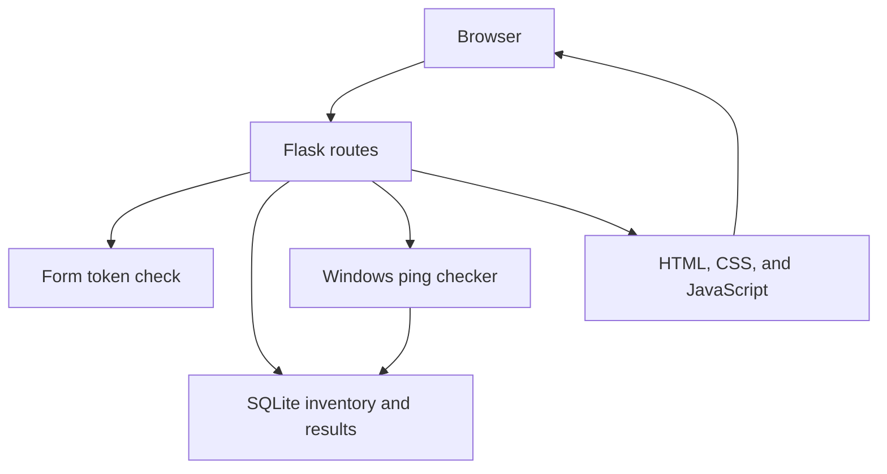

# Network Monitoring Dashboard

A local Windows prototype for a junior network technician or IT support portfolio. It keeps an inventory of devices you choose to monitor, checks those devices with Windows ping, stores each result, and shows the latest status on a dashboard.

This is a learning project. It runs on your own computer and does not discover devices, scan a subnet, or manage a production network.

## Features

- Add a device with a name, IPv4 or IPv6 address, device type, and optional description.
- Reject a missing field, an invalid address, a duplicate address, and a broadcast, multicast, or unspecified address.
- Show every saved device on one dashboard, with counts for total, online, offline, unknown, and error.
- Leave a device **Unknown** until a check result has been saved. The dashboard does not invent a status.
- **Check now** pings one saved device. **Check all** pings up to 20 saved devices, two at a time.
- Store every finished check in SQLite, including an error when a check cannot be completed.
- Show the latest response time and check time from the newest saved result.
- Open a device page with up to 20 of the most recent checks. Older rows stay in the database.
- Delete a device only after a confirmation page. The device and its monitoring history are removed together.
- Refresh the dashboard from the results already stored, without starting another ping.
- Provide a JSON health check at `/health`.

## Networking concepts

The project practices a few ideas used in network support:

- **Authorized inventory.** A technician monitors devices they are allowed to check. The app pings only addresses that were added to the inventory. It does not scan an IP range or accept a hostname.
- **ICMP echo.** **Check now** uses Windows `ping`, which sends an ICMP echo request and waits for an echo reply. A reply makes the device **Online**. No reply before the timeout makes it **Offline**.
- **Response time.** Windows reports the round trip in milliseconds, such as `time=12ms`. A reply faster than 1 millisecond is reported as `time<1ms` and stored as 0 ms.
- **Unknown is not the same as offline.** Unknown means no check has been saved yet. Offline means a check ran and the device did not reply.
- **Ping is not proof that every service is up.** A firewall or host policy can block ICMP while the device is still reachable on another protocol. This app does not test TCP ports, websites, or name resolution.
- **One address, one device.** Broadcast and multicast addresses can represent many hosts, so they are rejected. Each saved address must be unique.
- **Check limits.** The default check sends 1 echo request and waits 1000 milliseconds. A repeated check is skipped for 15 seconds, and a second check is rejected while one is already running. These limits avoid sending a burst of traffic from a mis-click.

## Architecture

The browser talks only to Flask. Flask validates each form, then asks the database or the Windows ping checker to do the work. Pages are rendered on the server. A small script can reload the dashboard from saved results.



| Module | Responsibility |
|---|---|
| `run.py` | Starts the local server |
| `app/__init__.py` | Builds the Flask app, creates the database, and registers routes |
| `app/config.py` | Host, port, database path, ping limits, and history limit |
| `app/routes/devices.py` | Dashboard, add, detail, check, and delete pages |
| `app/routes/health.py` | `GET /health` |
| `app/database.py` | SQLite tables and parameterized queries |
| `app/monitoring.py` | Validates one saved address and runs Windows ping |
| `app/presentation.py` | Turns saved values into labels such as "12 ms" and "Not checked" |
| `app/csrf.py` | Checks the form token on submissions that change data |
| `app/templates/` | Server-rendered HTML |
| `app/static/` | Stylesheet and the small dashboard and form scripts |

The database has two tables:

- `devices` stores the name, IP address, device type, description, and the time the device was added.
- `monitoring_results` stores the device, status, response time in milliseconds when one was measured, a short error note when needed, and the time of the check.

## Technologies

| Technology | Why it is used |
|---|---|
| Python 3.11 or newer | The application, database access, IP validation, and ping command are all Python. SQLite, subprocess, and IP address parsing come with Python. |
| Flask 3.1.3 | Serves the local pages and forms without a separate frontend application. |
| SQLite | Stores the inventory and check history in one file on this PC. No database server is required. |
| HTML, CSS, and JavaScript | The dashboard, forms, and device page are server-rendered. JavaScript only refreshes saved results and shows a loading label. |
| pytest 9.1.1 | Runs automated tests. Ping tests use stand-in command output, so the test run does not send real network traffic. |

Flask also installs its required libraries, including Werkzeug and Jinja2. Those are not listed separately in `requirements.txt`.

## Windows setup

Install Python 3.11 or newer from [python.org](https://www.python.org/downloads/windows/). During setup, select **Add python.exe to PATH**.

Open PowerShell in this project folder:

```powershell
py -3 -m venv .venv
.\.venv\Scripts\python.exe -m pip install -r requirements.txt
```

Activate the environment when you want `python` and `pip` to point at it:

```powershell
.\.venv\Scripts\Activate.ps1
```

If PowerShell blocks the activation script, skip activation and call `.\.venv\Scripts\python.exe` directly. Do not install these packages into the global Python installation.

The first run creates these local files. Git ignores them:

- `instance/monitor.db`, the SQLite database
- `instance/secret_key`, the key that signs the local session cookie

## Run the application

From the project folder:

```powershell
.\.venv\Scripts\python.exe run.py
```

Open the dashboard at `http://127.0.0.1:5000/devices`.

The server listens on `127.0.0.1` port `5000`, so only this computer can open it. Debug mode is off. Stop the server with Ctrl+C in that PowerShell window.

Confirm the process is running:

```powershell
.\.venv\Scripts\python.exe -c "import urllib.request; print(urllib.request.urlopen('http://127.0.0.1:5000/health').read().decode())"
```

The health check returns:

```json
{"application": "network-monitoring-dashboard", "status": "ok"}
```

## Run the tests

The tests do not need the web server to be running. From the project folder:

```powershell
.\.venv\Scripts\python.exe -m pytest
```

Ping tests replace the Windows command with saved examples of online, offline, timeout, and failed output. They do not contact the network.

## Add a device and check it

1. Start the application and open `http://127.0.0.1:5000/devices`.
2. Choose **Add device**.
3. Enter a device you are allowed to monitor. Use a real IP address from this PC or its local network, such as the IPv4 address shown by `ipconfig`. `127.0.0.1` is a safe loopback test.
4. Save the device. Its status is **Unknown**, and the response time and last checked time say **Not checked**.
5. Choose **Check now** on that row, or open the device and choose **Check now** there. The button says **Checking** while Windows ping runs.
6. After the page reloads, the status is **Online**, **Offline**, or **Error**. Online includes the response time in milliseconds. The device page lists the saved check.
7. **Check all** checks every saved device that is not still inside the 15-second wait, up to 20 devices. **Refresh status** reloads stored results and does not ping again.
8. **Delete** opens a confirmation page. The device is removed only after **Delete device** is submitted.

Use a device you control. Do not add an address at work, school, or another network unless you are allowed to monitor it.

## Screenshots to capture

Capture these from your own running app. Save them under `docs/screenshots/` with these filenames:

| Filename | What to show |
|---|---|
| `docs/screenshots/01-dashboard-empty.png` | Dashboard before any device is added, with zero counts and the empty-inventory message |
| `docs/screenshots/02-add-device-form.png` | The add-device form with its labels |
| `docs/screenshots/03-validation-error.png` | The form after an invalid IP address is submitted |
| `docs/screenshots/04-dashboard-unknown.png` | A saved device still marked Unknown and Not checked |
| `docs/screenshots/05-dashboard-after-check.png` | The same device after Check now, including status, response time, and last checked time |
| `docs/screenshots/06-device-history.png` | The device page with at least one saved monitoring result |
| `docs/screenshots/07-delete-confirmation.png` | The delete confirmation page before the device is removed |
| `docs/screenshots/08-dashboard-mobile.png` | The dashboard narrowed to a phone-sized window |

The images are not included in the repository yet. Take them while the app is running, then add the files before publishing the portfolio.

## Current limitations

- This is a local prototype. It is bound to `127.0.0.1` and is not a production monitoring system.
- There is no login. Anyone who can use this Windows session can open the dashboard.
- Connectivity checks use ICMP through Windows `ping` only. They use 1 attempt and a 1000 millisecond wait.
- A host or firewall that blocks ICMP can appear Offline even though it answers other traffic.
- Windows can also block `ping` when the command is not permitted. The app then saves an error instead of a response time.
- The app does not test TCP ports, DNS names, websites, switches through SNMP, or wireless signal strength.
- Nothing runs on a schedule. A check starts only when you use Check now or Check all.
- Check all handles at most 20 devices, two at the same time, and gives up on the batch after 30 seconds.
- The same device is not checked again until 15 seconds after its last saved result. Another check is also rejected while one check is already running in this app process.
- The device page displays the 20 most recent checks. Older checks remain stored.
- The web server is Flask's local development server with debug mode off.

## Possible later work

These items are not built:

- SNMP monitoring for interface status, uptime, or errors on managed network equipment.
- Authentication so each technician has their own login.
- Alerting when a device changes from Online to Offline.
- Charts of response time and availability over a longer history.
- Scheduled checks that run without pressing a button.
- TCP port checks for a service such as a web server or file share.
