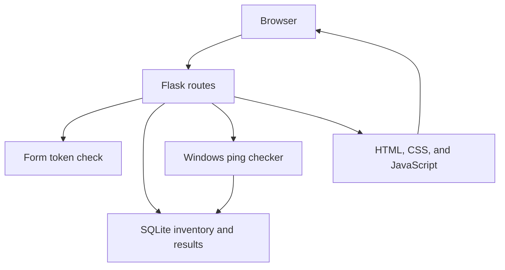

# Architecture

## Architecture

The browser only ever talks to Flask. Flask checks each form, then hands the work to the database or the Windows ping checker. Pages are rendered on the server, and a small script reloads the dashboard from saved results.

| Module | Responsibility |
|---|---|
| `run.py` | Starts the local server |
| `app/__init__.py` | Builds the Flask app, creates the database, and registers routes |
| `app/config.py` | Host, port, database path, ping limits, and history limit |
| `app/routes/devices.py` | Dashboard, topology, add, edit, detail, check, and delete pages |
| `app/routes/site.py` | Home, reports, and about. These pages only read saved data |
| `app/routes/health.py` | `GET /health` |
| `app/routes/agent.py` | Agent API for hosted mode: `GET /api/agent/devices` and `POST /api/agent/results`, both behind the agent key |
| `app/auth.py` | Admin sign-in and sign-out, the sign-in rate limit, and hiding addresses and descriptions when signed out |
| `agent/agent.py` | Home agent for hosted mode. Runs once: fetch devices, check them, post the results |
| `tools/zyber_secrets.py` | Makes the agent key and the admin password hash |
| `tools/make_icons.py` | Draws the app icons `icon-192.png` and `icon-512.png` with the standard library |
| `app/database.py` | SQLite tables and parameterized queries |
| `app/monitoring.py` | Validates one saved address, runs Windows ping, and connects to an allowed TCP port |
| `app/presentation.py` | Turns saved values into labels, Toronto times, the topology map, the latency chart, and the status bars |
| `app/csrf.py` | Checks the form token on submissions that change data |
| `app/templates/` | Server-rendered HTML, including `app/templates/site/` for home, reports, and about |
| `app/static/` | `style.css`, `theme-terminal.css`, `site.css`, `effects.css`, the dashboard and form scripts, `site.js`, `effects.js`, the `grain.svg` texture, the `logo-yo.svg` initials logo (also the favicon), the older `favicon.svg`, and three static page images |

The main tables are these (SNMP polls and interfaces have their own two tables):

- `devices` stores the name, IP address, device type, description, optional location, optional VLAN, optional parent device, and the time the device was added.
- `monitoring_results` stores the device, status, response time in milliseconds when one was measured, a short error note when needed, whether the check was ping or TCP, the TCP port when one was used, the ping minimum, median, maximum, jitter, and packet loss when those were measured, and the UTC time of the check.
- `status_changes` stores a device, the previous status, the new status, and the UTC time. A row is added only when the new status differs from the previous saved result.
- `check_requests` stores Check now requests queued in hosted mode: the device, ping or TCP and port, when it was asked for, and when the agent finished it.

## Technologies

| Technology | Why I used it |
|---|---|
| Python 3.11 or newer | The application, database access, IP validation, ping command, and TCP connection are all Python. SQLite, subprocess, sockets, and time zones come with Python. |
| Flask 3.1.3 | Serves the local pages and forms without a separate frontend application. |
| SQLite | Stores the inventory and check history in one file on this PC. No database server is required. |
| HTML, CSS, and JavaScript | Pages are server-rendered. `style.css` holds the layout. `theme-terminal.css` is the Cyber terminal theme. `site.css` is the home, reports, and about layout. `effects.css` loads last and holds the page transitions, texture, topology animation, live pulse, and scroll story. JavaScript refreshes saved results, shows a loading label, and runs the page effects. Those effects do not run when reduced motion is on. There is no framework and no CDN. GSAP is vendored in `app/static/vendor/` and loads only on the home page. |
| pytest 9.1.1 | Runs automated tests. Ping tests use stand-in command output, and TCP tests use a stand-in socket, so the test run does not send real network traffic. |

Flask also installs its required libraries, including Werkzeug and Jinja2. Those are not listed separately in `requirements.txt`.
